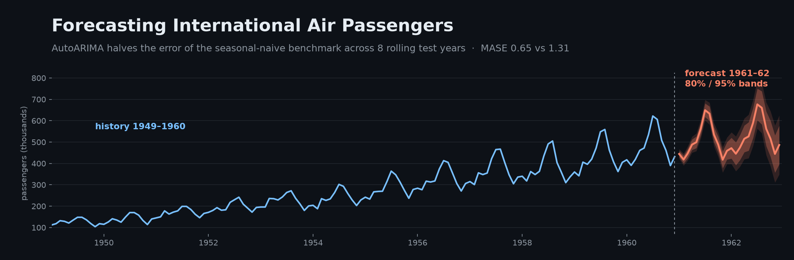
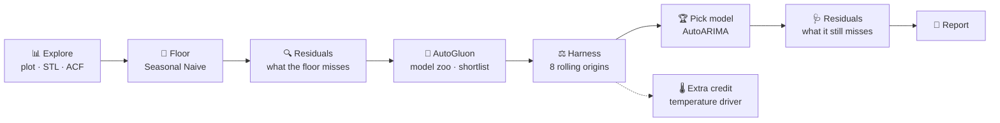
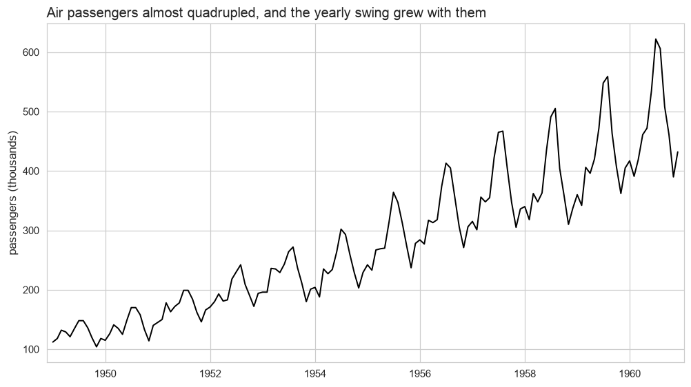
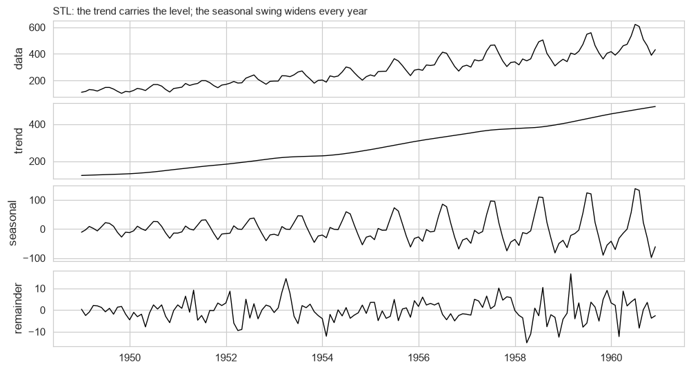
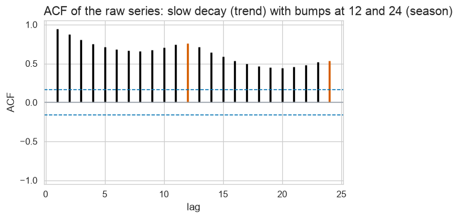

<div align="center">



# ✈️ Forecasting International Air Passengers

**An end-to-end time-series forecasting pipeline — from exploration to an honest, cross-validated forecast**

[](https://colab.research.google.com/github/Layanharbi9/air-passengers-forecasting/blob/main/project.ipynb)


**Layan Mohammed Alharbi** · Capstone, Time Series course · [@SDAIAAcademy](https://github.com/SDAIAAcademy)

[Results](#-results-at-a-glance) · [Pipeline](#-the-pipeline) · [Exploration](#-1-exploration) · [Harness](#%EF%B8%8F-4-the-harness--8-test-years) · [Best model](#-5-the-winner-autoarima) · [Report](report.md) · [Notebook](project.ipynb)

</div>

---

## 🎯 Results at a glance

<table>
<tr>
<td align="center" width="25%"><h2>−51%</h2><sub>forecast error vs the benchmark<br/><b>MASE 0.65 vs 1.31</b></sub></td>
<td align="center" width="25%"><h2>7 / 8</h2><sub>test years where the model<br/><b>beats the benchmark</b></sub></td>
<td align="center" width="25%"><h2>−45%</h2><sub>better forecast distribution<br/><b>scaled CRPS 0.034 vs 0.062</b></sub></td>
<td align="center" width="25%"><h2>6.04 M</h2><sub>passengers forecast for 1961<br/><b>vs 5.71 M in 1960</b></sub></td>
</tr>
</table>

> [!TIP]
> **Recommendation:** ship **AutoARIMA** — across eight rolling test years it cuts the error of the
> "same month last year" benchmark roughly **in half**, and is the best model on the whole forecast
> distribution, not just the point forecast.

> [!WARNING]
> **Honest caveat:** its 80% prediction band covered **70%** of real months, not 80% — the errors grow
> with the traffic. Treat the band as ≈70% until the next step (a log transform) is in place.

---

## 📌 The problem

| | |
|---|---|
| **Data** | Monthly international airline passengers, **Jan 1949 – Dec 1960** — 144 months, no gaps (Box & Jenkins, 1970) |
| **Goal** | Forecast the next 12–24 months **and** prove it beats the simplest sensible forecast |
| **Rules** | ✅ a benchmark floor &nbsp; ✅ rolling-origin cross-validation &nbsp; ✅ scored intervals &nbsp; ✅ no data leakage |
| **Graded on** | *the process, not the number* — an honest analysis beats a lucky score |

---

## 🔄 The pipeline



---

## 🧰 Tech stack — and why

<table>
<tr><th>Category</th><th>Tool</th><th>Why it's here</th></tr>
<tr><td rowspan="2">🐍 Core</td><td><b>Python 3.12</b>, <b>pandas</b>, <b>NumPy</b></td><td>data handling and calculations</td></tr>
<tr><td><b>Jupyter / Google Colab</b></td><td>the notebook must run top to bottom on Colab</td></tr>
<tr><td rowspan="2">📈 Classical TS</td><td><b>statsmodels</b></td><td>dataset, STL decomposition, ACF — the reference implementation</td></tr>
<tr><td><b>statsforecast</b> (Nixtla)</td><td>fast models with built-in rolling cross-validation and prediction intervals</td></tr>
<tr><td>🤖 AutoML</td><td><b>AutoGluon TimeSeries</b></td><td>fits a whole model zoo in one call — used to <i>shortlist</i></td></tr>
<tr><td>📏 Scoring</td><td><b>utilsforecast</b> + course <b>coursekit</b></td><td>MASE · RMSSE · scaled CRPS, each fold scored only on data it was allowed to see</td></tr>
<tr><td>🎨 Charts</td><td><b>matplotlib</b> · <b>seaborn</b></td><td>every chart carries its claim in its title</td></tr>
<tr><td>🌡️ External data</td><td><b>Open-Meteo</b> archive API</td><td>free historical temperature (ERA5), cached as CSV</td></tr>
</table>

<details>
<summary><b>🧪 Techniques used — and why each one</b> (click to expand)</summary>

<br/>

| technique | why |
|---|---|
| **STL decomposition** | separates trend, season and remainder — shows which does the work and that the season is *multiplicative* |
| **Trend & seasonal strength** | turns the decomposition into two numbers (both ≈ 1) → a model *must* carry trend **and** season |
| **ACF** | the lag-12 spike proves the yearly season; on residuals it reveals what a model left behind |
| **Residual analysis** | tells *what* a model missed (trend? momentum? season?) and therefore which model can fix it |
| **Prediction intervals** | managers need the uncertainty, not just the guess; the 80% band is checked for honesty |
| **Rolling-origin cross-validation** | 8 forecast origins instead of one lucky holdout — a ranking you can trust |
| **Leakage-free folds** | every fit and score sees only the past; otherwise the test is fake |
| **Dynamic regression** | tests whether an outside driver (temperature) adds information beyond the calendar |

</details>

<details>
<summary><b>🧠 Models — and why each one</b> (click to expand)</summary>

<br/>

| model | type | why |
|---|---|---|
| **Seasonal Naive** — *the floor* | benchmark | next month = same month last year — the minimum any model must beat |
| **Naive** | benchmark | no season — shows what ignoring seasonality costs |
| **Naive with drift** | benchmark | trend but no season — the opposite gap to the floor |
| **AutoARIMA** 🏆 | seasonal ARIMA | handles trend, season and momentum — exactly what the floor leaves behind |
| **AutoETS** | exponential smoothing | the other classic family for trended seasonal data |
| **AutoTheta** | Theta method | a strong, simple competition-winning method |
| **WeightedEnsemble** | AutoGluon blend | tests whether mixing beats any single model |
| **AutoARIMA + temperature** | dynamic regression | does weather add information beyond the season? |

</details>

<details>
<summary><b>📏 Metrics — and why there is no "accuracy %"</b> (click to expand)</summary>

<br/>

| metric | measures | better |
|---|---|---|
| **MASE** | average error relative to the seasonal-naive error (< 1 beats the floor) | lower ⬇️ |
| **RMSSE** | like MASE but penalises big misses more | lower ⬇️ |
| **Scaled CRPS** | quality of the *whole* forecast distribution | lower ⬇️ |
| **80% coverage** | share of real months inside the 80% band | closest to 80% 🎯 |
| **80% band width** | how wide the band is — the price paid for coverage | narrower, if honest |

*Accuracy % is a classification metric. Forecasts are judged by **how far off** they are, how good the **range** is, and whether the range is **honest**.*

</details>

---

## 📊 1. Exploration

<table>
<tr>
<td width="50%"></td>
<td width="50%"></td>
</tr>
<tr>
<td><b>Growth + a yearly pattern.</b> 127k → 476k passengers/month; summer peak, November low — and the summer swing grows with the traffic (44k → 232k).</td>
<td><b>STL.</b> The trend does most of the work; the seasonal amplitude grows almost fivefold → <b>multiplicative</b> seasonality.</td>
</tr>
</table>

| measure | value | implication |
|---|:---:|---|
| Trend strength | **1.00** | the model must carry a **trend** |
| Seasonal strength | **0.99** | the model must carry a **season** |

<p align="center"></p>

> **In one sentence:** *"The number keeps going up, and every month looks a lot like the same month a year earlier."*

---

## 🧱 2. The floor — and what it leaves on the table

The benchmark every model must beat: **Seasonal Naive** — *next January = last January*.

<p align="center"></p>

| left in the floor's errors | evidence | fixed by |
|---|---|---|
| 📈 **Trend** | residuals average **+32k**, not 0 | differencing / a trend state |
| 🔁 **Momentum** | ACF **0.75 · 0.65 · 0.50** at lags 1–3 | an AR term |
| 📅 **Season** | ACF **−0.04** at lag 12 — fully used | nothing needed |

**Its 80% band covers only 51%** of real months → ❌ *not honest*.

---

## 🤖 3. The framework — AutoGluon

Data converted **by hand** (`unique_id → item_id`, `ds → timestamp`) and a zoo of 5 local models + an ensemble fitted.

| model | score_test *(1960)* | score_val *(1959)* |
|---|:---:|:---:|
| 🥇 AutoARIMA | **−0.61** | −1.58 |
| Theta | −0.88 | −1.63 |
| WeightedEnsemble | −0.93 | **−1.54** |
| AutoETS | −1.17 | −1.55 |
| SeasonalNaive | −1.57 | −1.66 |
| Naive | −2.50 | −3.20 |

- ➖ **Negative scores** — AutoGluon flips error metrics so "higher is better": −0.61 = MASE 0.61.
- 1️⃣ **One window each** — and the ranking **flips** between 1959 and 1960.
- ✅ Good for **shortlisting** · ❌ not for **ranking** → the shortlist goes to the harness.

---

## ⚖️ 4. The harness — 8 test years

Each model forecasts 12 months ahead from **8 origins** (end of 1952 … 1959), on the **same folds** as the floor.

| rank | model | MASE ⬇️ | RMSSE ⬇️ | scaled CRPS ⬇️ | 80% coverage 🎯 | band width |
|:---:|---|:---:|:---:|:---:|:---:|:---:|
| 🥇 | **AutoARIMA** | **0.647** | **0.683** | **0.034** | **69.8%** | 44k |
| 🥈 | AutoTheta | 0.898 | 0.988 | 0.046 | 59.4% | 58k |
| 🥉 | AutoETS | 0.952 | 1.003 | 0.050 | 49.0% | 49k |
| 4 | Seasonal Naive *(floor)* | 1.313 | 1.246 | 0.062 | 51.0% | 78k |
| 5 | Naive with drift | 1.813 | 2.156 | 0.095 | 76.0% | 149k |
| 6 | Naive | 2.119 | 2.452 | 0.110 | 68.8% | 143k |

<p align="center"></p>

| | finding |
|---|---|
| ✅ | **AutoARIMA wins both halves** — −51% on the point forecast, −45% on the distribution |
| ✅ | beats the floor in **7 of 8 years**; loses only in **1958**, when growth stalled |
| ⚠️ | **AutoETS**: wins on accuracy but its band covers *less* than the floor's (49% vs 51%) |
| ⚠️ | every useful band is **too narrow** — misses come a whole year at a time (1955: 50%, 1959: 0%) |
| ℹ️ | only *drift* reaches the honest range (76%) — by being 3× wider and less accurate |

---

## 🏆 5. The winner: AutoARIMA

**Selected:** `ARIMA(1,1,0)(0,1,0)[12]` — one regular difference *(removes the trend)*, one seasonal difference *(removes the season)*, one AR term *(the momentum the floor left behind)*.

<p align="center"></p>

| horizon | 80% band width |
|---|:---:|
| month 1 | 30k |
| month 12 | 82k |
| month 24 | 181k |

<details>
<summary><b>🩺 What the model still misses — residual check</b> (click to expand)</summary>

<br/>

<p align="center"></p>

- ✅ Residuals centred on zero; no pattern at lags 1–3, 12 or 24 — trend and momentum absorbed.
- ℹ️ One crossing at lag 23 — the ~1-in-24 false alarm expected by chance.
- ⚠️ Residuals are **~1.5× larger in 1957–60 than 1950–53**: the model works on raw counts and assumes
  a constant error size, so its band is too narrow in busy years.

</details>

---

## 🌡️ 6. Extra credit — does weather drive traffic?

Monthly mean temperature at **New York (JFK)** from [Open-Meteo](https://open-meteo.com/), cached in [`data/`](data/).
**No leakage:** each fold uses the average temperature per month from **its own past years only**.

| model | MASE | CRPS | 80% coverage |
|---|:---:|:---:|:---:|
| AutoARIMA | **0.647** | 0.034 | 69.8% |
| AutoARIMA + temperature | 0.665 | 0.034 | 70.8% |

**Verdict:** ❌ temperature doesn't help — it repeats the seasonal pattern the model already has.
A useful driver must carry information the calendar doesn't (fares, income, route capacity).

---

## 💡 Conclusions

1. 🏆 **Ship AutoARIMA** — it halves the benchmark's error over eight test years.
2. 🎯 **Read its 80% band as ≈70%** until the band is fixed.
3. 🔧 **Next step:** model the **logarithm** of passengers so errors scale with traffic — expected to
   narrow the band in quiet years, widen it in busy ones, and move coverage toward 80%.
4. ⚖️ **One holdout is not a ranking** — AutoGluon's single-window leaderboard flipped between
   neighbouring years; only the 8-year harness settled it.

---

## 🚀 Run it

**▶️ Colab:** click the badge at the top — the first cell installs everything.

**💻 Locally** (Python 3.11 – 3.13):

```bash
git clone https://github.com/Layanharbi9/air-passengers-forecasting.git
cd air-passengers-forecasting
python -m venv .venv && source .venv/bin/activate
pip install -e . "autogluon.timeseries" jupyter
jupyter nbconvert --to notebook --execute project.ipynb   # ~30 seconds
```

## 📁 Repository structure

```text
air-passengers-forecasting/
├── project.ipynb        # the full analysis
├── report.md            # 2–3 page report for a manager
├── figures/             # every chart, saved by the notebook
├── data/
│   └── temperature_nyc_monthly.csv   # cached driver (extra credit)
├── coursekit/           # course plotting + scoring harness (SDAIA Academy)
└── pyproject.toml
```

---

<div align="center">

**Layan Mohammed Alharbi**

Capstone for the Time Series course · [@SDAIAAcademy](https://github.com/SDAIAAcademy)

[](https://github.com/Layanharbi9)
[](https://linkedin.com/in/layan-alharbi-b65a78363)
[](https://layanharbi9.github.io/)

<sub>Data: Box, G. E. P. & Jenkins, G. M. (1970) · Course materials and `coursekit` © SDAIA Academy</sub>

</div>
